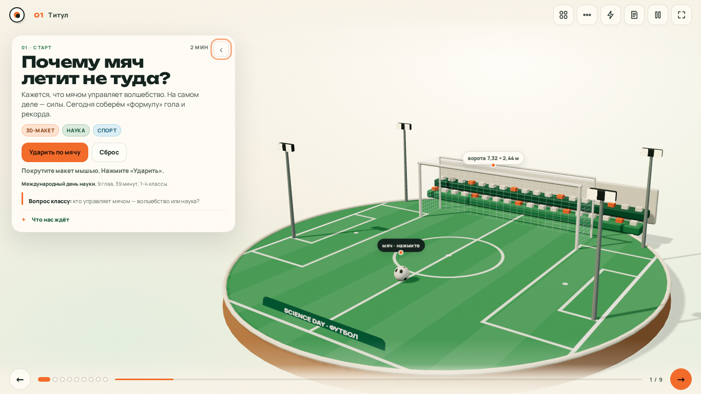
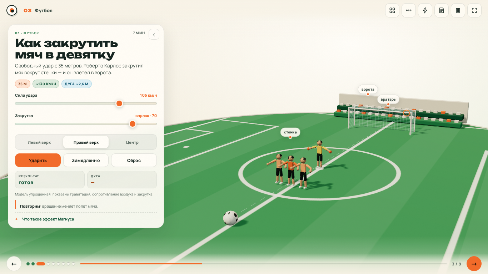
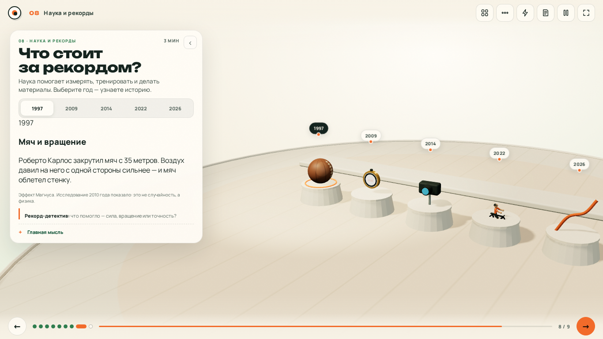
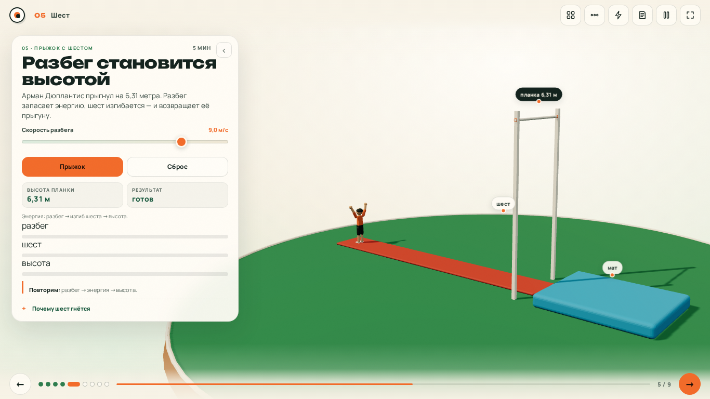
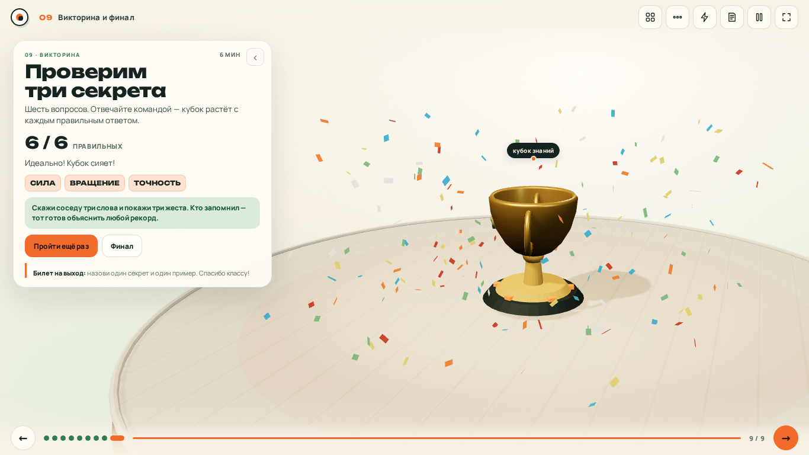

# Физика безупречного гола

### Интерактивный 3D-лекторий к Международному дню науки

**9 глав · 39 минут · 1–4 классы · ноутбук + проектор · полностью офлайн**

[](https://xondell.github.io/science-day-physics/)
[](#быстрый-старт)
[](https://threejs.org/)
[](#что-внутри)
[](LICENSE)



---

## Что это

Урок, с которым можно **двойным кликом** открыть презентацию на ноутбуке и пойти по классам. Без интернета, установки, аккаунтов и CDN.

Футбол — яркий вход. Дальше — спринт, прыжок с шестом, велосипед, плавание, теннис и баскетбол. На каждой главе — **настоящая 3D-сцена** и действие: ударить по мячу, закрутить его, поймать зелёный сигнал, разогнать шест, изменить позу, выбрать рекорд.

Главная мысль повторяется словами, жестами и викториной:

> **СИЛА · ВРАЩЕНИЕ · ТОЧНОСТЬ**

---

## Почему это работает

| | |
|---|---|
| **Сказать — показать — повторить** | Короткая фраза, сразу движение в 3D, затем вопрос классу. |
| **Три слова-жеста** | «Сила» — топнуть. «Вращение» — покрутить рукой. «Точность» — показать на цель. |
| **Понятно младшим** | Короткие объяснения; дополнительные подробности раскрываются по желанию. |
| **Не боится проектора** | Проверено на 1366×768, 1920×1080 и 4:3. Панель можно свернуть. |
| **Не боится сбоя** | Если WebGL недоступен — остаются статичные схемы, текст и викторина. |

---

## Что внутри

| № | Глава | Время | 3D и действие |
|---:|---|---:|---|
| 1 | **Титул.** Почему мяч летит не туда? | 2 мин | Стадион, удар по мячу, гол и конфетти |
| 2 | **Три секрета.** Сила · вращение · точность | 4 мин | Три объекта, подсветка, «Проверь память» |
| 3 | **Футбол.** Как закрутить мяч в девятку | 7 мин | Сила, закрутка, цель, вратарь, дуга полёта |
| 4 | **Спринт.** Реакция и скорость | 4 мин | Стартовый свет, реакция, сравнение с Болтом |
| 5 | **Шест.** Разбег становится высотой | 5 мин | Ползунок скорости, изгиб шеста, планка 6,31 м |
| 6 | **Сопротивление.** Почему они наклоняются? | 5 мин | Велосипед/плавание, поза, поток частиц |
| 7 | **Вращение везде.** Один секрет — разные мячи | 3 мин | Футбол, теннис, баскетбол и траектория |
| 8 | **Музей рекордов.** Что стоит за рекордом? | 3 мин | Пять объектов, клик по 3D, годы 1997–2026 |
| 9 | **Викторина и финал.** Проверим три секрета | 6 мин | 6 вопросов, растущий кубок, конфетти |

**Итого: 39 минут.** Разминка на 60 секунд (`W`) добавляется по желанию.

---

## Быстрый старт

1. Скачайте папку проекта **целиком** — `index.html` и `assets/` должны лежать рядом.
2. Откройте `index.html` двойным кликом.
3. Нажмите `F` — полный экран.
4. Нажмите `N` — заметки лектора. Нажмите `T` — свернуть панель.

> Интернет не нужен. Шрифты, Three.js и все модели лежат внутри проекта.

**Онлайн-версия:** [xondell.github.io/science-day-physics](https://xondell.github.io/science-day-physics/)

---

## Управление

| Клавиша / кнопка | Действие |
|---|---|
| `→` `↓` `PageDown` `Space` | Следующая глава |
| `←` `↑` `PageUp` | Предыдущая глава |
| `Home` / `End` | Первая / последняя глава |
| `#3` в адресе | Открыть главу 3 |
| `F` | Полный экран |
| `N` | Заметки лектора |
| `T` | Свернуть / вернуть панель |
| `M` | Список глав |
| `S` | Три секрета |
| `W` | Разминка 60 секунд |
| `Esc` | Закрыть оверлей |
| Мышь | Вращение, зум, клик по 3D-объекту |
| `Пробел` в главе 4 | Реакция на зелёный сигнал |

---

## Для учителя

- [**Сценарий урока**](docs/lesson-script.md) — 39 минут, речь, действия, вопросы, упрощения для 1–2 и 3–4 классов.
- [**Викторина**](docs/quiz.md) — 6 вопросов с ответами и объяснениями.
- [**Источники**](docs/sources.md) — ссылки и честные оговорки о моделях.
- [**Покрытие требований**](docs/requirements-coverage.md) — что и как выполнено.
- [**QA-отчёт**](docs/qa-report.md) — проверки, результаты, найденные и исправленные дефекты.

**Совет:** перед классом откройте главу 1, нажмите «Ударить по мячу» и убедитесь, что сцена вращается. Если проектор 4:3 — сверните панель `T`.

---

## Скриншоты

| Футбол: сила, вращение, точность | Музей: клик по 3D-объекту |
|---|---|
|  |  |

| Прыжок с шестом | Финал викторины |
|---|---|
|  |  |

Больше: [все скриншоты](qa/screenshots/) — 49 файлов, три разрешения, панель открыта и закрыта, WebGL-off.

---

## Технически

```text
science-day-physics/
├── index.html                  # оболочка, шапка, оверлеи
├── assets/
│   ├── css/styles.css          # визуальная система
│   ├── js/
│   │   ├── content.js          # тексты, заметки, викторина, музей
│   │   ├── models.js           # процедурные low-poly модели
│   │   ├── scenes.js           # 9 сцен и физика взаимодействий
│   │   └── app.js              # движок презентации
│   ├── vendor/three.global.js  # Three.js r170 + OrbitControls
│   ├── fonts/                  # Unbounded + Manrope, OFL
│   └── fallback/               # 9 постеров для WebGL-off
├── docs/                       # сценарий, викторина, источники, QA
└── qa/screenshots/             # доказательства проверок
```

- **Без сборки:** классические `<script>`, без ES-модулей, `fetch`, CDN и внешних GLB.
- **Один WebGL-контекст:** общий renderer, сцены создаются лениво и кешируются.
- **Панель не закрывает героя:** камера смещается через `setViewOffset` в свободную область.
- **Устойчивость:** `prefers-reduced-motion`, WebGL-fallback, пауза автоповорота, `file://`.
- **Доступность:** клавиатура, `aria-pressed`, видимый фокус, подписи сцены.

---

## QA в двух строках

Проверено на **1366×768**, **1920×1080** и **1024×768**: 9/9 сцен, основные взаимодействия, викторина 6/6, фальстарт, клики по 3D, fullscreen, заметки, reduced motion, WebGL-off, 3 прохода с одним canvas (память отдельно не профилировалась).  
**0 внешних запросов · 0 ошибок консоли · 0 горизонтального overflow.**

Подробно: [docs/qa-report.md](docs/qa-report.md).

---

## Лицензии

- **Код проекта:** [MIT](LICENSE).
- **Шрифты:** Unbounded и Manrope — SIL Open Font License, тексты лицензий в `assets/fonts/`.
- **Three.js:** MIT, `assets/vendor/three.global.js`.
- **Факты и рекорды:** ссылки и дата проверки — в [docs/sources.md](docs/sources.md).

---

<p align="center">
  <b>СИЛА · ВРАЩЕНИЕ · ТОЧНОСТЬ</b><br>
  <sub>Сделано для Международного дня науки · 2026</sub>
</p>
